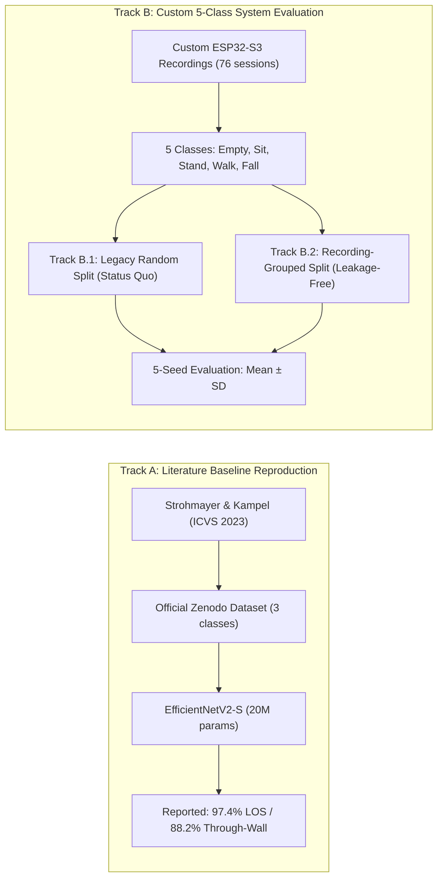

# Experimental Protocol and Reproducibility Standards

**Project:** Privacy-Preserving Through-Wall Human Activity Recognition Using WiFi-CSI  
**Document Status:** Approved Scientific Evaluation Standard  
**Date:** October 2026  

---

## 1. Dual Evaluation Tracks

To avoid conflating disparate datasets, classes, and recording environments, all experiments are categorized into two distinct tracks:

### Track A: Literature Baseline Reproduction (Strohmayer & Kampel 2023)
- **Objective:** Establish the documented baseline of through-wall ESP32 activity recognition.
- **Task:** 3 classes (*Empty, Walking, Walking+Arm-wave*).
- **Protocol:** Hampel outlier filter, STFT amplitude spectrograms, 400-packet windows (~4.0 s), 8:1:1 split, balanced sampler, Adam ($\text{lr}=10^{-4}$), 400 epochs.
- **Reporting Rule:** Reported numbers from Track A serve as the foundational benchmark for through-wall ESP32 feasibility, but cannot be directly contrasted against Track B accuracy numbers as proof of algorithmic superiority.

### Track B: Custom 5-Class System Evaluation
- **Objective:** Evaluate and improve model performance on our ESP32-S3 hardware setup with 5 classes including safety-critical fall events and fine-grained static postures (*Sitting vs. Standing*).
- **Sub-track B.1 (Legacy Random Split):**
  - Evaluates models on the 2,241 windows in `Data/MyCSI/` (70% train, 15% val, 15% test).
  - Preserved as a historical reference to reproduce previous repository claims (96.54% ± 2.03 pp).
- **Sub-track B.2 (Leakage-Resistant Grouped Split):**
  - Quarantines all 76 recording files at the file level before windowing.
  - Test set consists of completely unseen recording sessions (0% window overlap with training).
  - Serves as the primary, scientifically defensible measure of real-world generalization.

---

## 2. Experimental Rigor and Leakage Prevention

### A. Preprocessing Fitted Exclusively on Training Data
- Normalization bounds ($\min, \max$) or standardized statistics ($\mu, \sigma$) must be calculated **exclusively on the training split**.
- The validation set, test set, and live inference streams use the stored training statistics without modification.
- Fitting normalization on the test set is strictly prohibited.

### B. Prevention of Temporal Leakage
- Window length: $W = 250$ packets (2.5 s at 100 Hz).
- Stride: $S = 50$ packets (0.5 s step).
- In Track B.2, splitting is executed **before window generation**. All windows from a single recording session stay together in either Train, Validation, or Test.

### C. Multi-Seed Robustness Standard
- All primary models are evaluated across 5 random seeds:
  $$\text{Seeds} \in \{42, 123, 456, 789, 2024\}$$
- Every seed re-initializes weights from scratch, re-shuffles the training data loader, and initializes dropout masks.
- Results are reported as **Mean $\pm$ Sample Standard Deviation** ($s$ with $n-1 = 4$ degrees of freedom):
  $$\bar{x} = \frac{1}{n} \sum_{i=1}^{n} x_i, \qquad s = \sqrt{\frac{1}{n-1} \sum_{i=1}^{n} (x_i - \bar{x})^2}$$
- Reporting only the single best seed is prohibited.

---

## 3. Training Hyperparameters

| Hyperparameter | Value | Scientific Justification |
| :--- | :--- | :--- |
| **Optimizer** | Adam ($\beta_1 = 0.9, \beta_2 = 0.999$) | Adaptive per-parameter learning rate suits heterogeneous convolutional and recurrent weights. |
| **Learning Rate** | $5 \times 10^{-4}$ ($0.0005$) | Half standard default ($10^{-3}$); prevents recurrent gradient instability and catastrophic forgetting. |
| **Batch Size** | 32 | Balances stochastic gradient noise for generalization with vectorization throughput on CPU. |
| **Maximum Epochs** | 25–40 | Squeezes convergence without late-stage overfitting (controlled experiments show 75 epochs overfit). |
| **Early Stopping** | Patience = 6–10 epochs | Halts training when validation Macro-F1 ceases improving, restoring best checkpoint state. |
| **Weight Decay** | $1 \times 10^{-4}$ ($0.0001$) | $L_2$ regularization penalty prevents convolutional weights from inflating. |
| **Dropout** | 0.10–0.15 | Stochastically zeros 10–15% of feature map activations to discourage feature co-adaptation. |
| **Class Weighting** | $w_c = \frac{N}{C \cdot N_c}$ | Inversely scales cross-entropy loss by class frequency, penalizing false negatives on Falling by ~3.8×. |

---

## 4. Evaluation Metrics & Scientific Interpretation

Because human activity recognition in eldercare is safety-critical and highly imbalanced, overall accuracy alone is inadequate:

1. **Overall Accuracy (OA)**:
   $$\text{OA} = \frac{\sum_{c} \text{TP}_c}{N_{\text{total}}}$$
   Baseline threshold: A trivial majority classifier predicting "Empty" achieves $37.5\%$.
2. **Balanced Accuracy (BA)**:
   $$\text{BA} = \frac{1}{C} \sum_{c=1}^{C} \text{Recall}_c$$
   Unweighted mean of per-class recalls. Unaffected by class imbalance.
3. **Macro-Averaged Precision, Recall, and F1**:
   $$\text{Macro-F1} = \frac{1}{C} \sum_{c=1}^{C} \frac{2 \cdot P_c \cdot R_c}{P_c + R_c}$$
   Weights all 5 classes equally. A model that misses all falls will suffer a severe Macro-F1 penalty regardless of how well it predicts Empty or Walking.
4. **Minority Safety Metrics (Falling Specific)**:
   - **Falling Recall (Sensitivity):** $\frac{\text{TP}_{\text{Fall}}}{\text{TP}_{\text{Fall}} + \text{FN}_{\text{Fall}}}$ (Safety critical: measures missed falls).
   - **Falling Miss Rate (False Negative Rate):** $1 - \text{Recall}_{\text{Fall}}$.
   - **Falling Precision:** $\frac{\text{TP}_{\text{Fall}}}{\text{TP}_{\text{Fall}} + \text{FP}_{\text{Fall}}}$ (Economic critical: measures false alarms).
5. **Inference Latency & Throughput**:
   - Single-window execution time in milliseconds ($ms$) on host CPU.
   - Theoretical throughput in windows/sec. Ensures model can easily keep pace with real-time sliding windows ($0.5\text{ s} = 500\text{ ms}$ interval).
