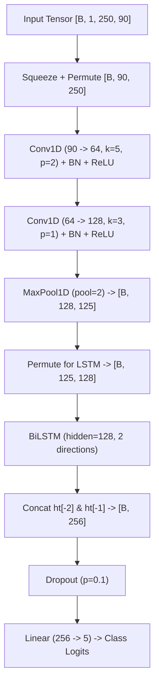
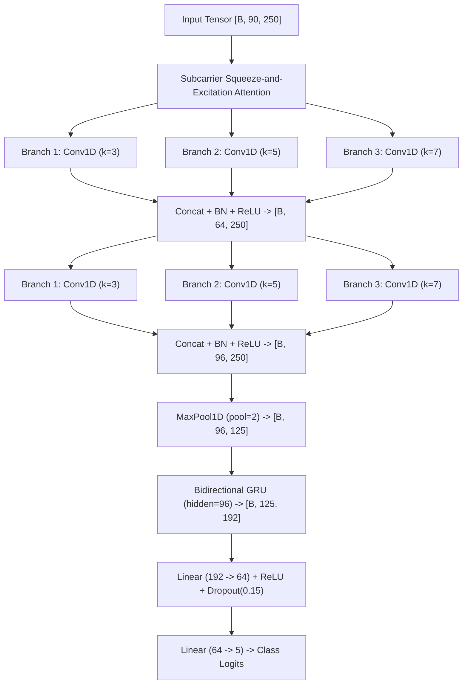

# Neural Network Architectures for WiFi-CSI Human Activity Recognition

**Project:** Privacy-Preserving Through-Wall Human Activity Recognition Using WiFi-CSI  
**Hardware Platform:** Espressif ESP32-S3 (Dual-Core Xtensa LX7 @ 240 MHz, 2.4 GHz 802.11n HT40)  
**Input Representation:** $250 \text{ packets} \times 90 \text{ amplitude subcarrier features}$ (~2.5 s window @ 100 Hz)  

---

## 1. Physical Signal Grounding & Tensor Dimensionality

### A. The Input Tensor Layout
A Wi-Fi packet received at time step $t$ contains $N=90$ interpolated CSI subcarrier magnitudes. Across a sliding window of $T=250$ consecutive packets, the data forms a matrix of size $250 \times 90$.

In PyTorch, a 1D Convolution (`nn.Conv1d`) expects input tensors of shape:
$$\text{Input: } [\text{Batch}, \text{Channels}, \text{Length}]$$

#### The "Wrong" Formulation (Historical Bug):
$$\mathbf{X} \in \mathbb{R}^{B \times 250 \times 90}$$
Here, the 250 time packets are treated as **channels**, and the convolution filter slides along the 90 frequency subcarriers.
- **Why this fails physically:** Each convolutional output mixes all 250 time steps at once, destroying chronological order in the very first layer. Locality is enforced across subcarriers rather than across time.

#### The "Correct" Formulation:
$$\mathbf{X} \in \mathbb{R}^{B \times 90 \times 250}$$
$$\text{Squeeze: } [B, 1, 250, 90] \to [B, 250, 90] \quad \xrightarrow{\text{Permute(0, 2, 1)}} \quad [B, 90, 250]$$
- **Why this matches RF physics:** The 90 subcarriers are treated as 90 parallel sensor channels. The convolution kernel slides along the 250 time steps, acting as a **learned temporal filter bank**. It detects local Doppler oscillations across all subcarrier frequencies simultaneously.

---

## 2. Baseline Architectures

### Baseline 1: Multi-Layer Perceptron (MLP)
- **Input:** Flattened vector of $250 \times 90 = 22,500$ features.
- **Layers:**
  1. `Linear(22500, 512)` + `BatchNorm1d(512)` + `ReLU` + `Dropout(0.3)`
  2. `Linear(512, 128)` + `BatchNorm1d(128)` + `ReLU` + `Dropout(0.2)`
  3. `Linear(128, 5)`
- **Parameters:** **11,588,101**
- **Characteristics:** Extremely parameter-heavy; lacks translational invariance in time; prone to severe overfitting on small datasets.

### Baseline 2: LeNet (2D Image CNN)
- **Input:** Grayscale 2D image $[B, 1, 250, 90]$.
- **Layers:**
  1. `Conv2d(1, 16, kernel_size=5, padding=2)` + `BN` + `ReLU` + `MaxPool2d(2)` $\to [B, 16, 125, 45]$
  2. `Conv2d(16, 32, kernel_size=5, padding=2)` + `BN` + `ReLU` + `MaxPool2d(2)` $\to [B, 32, 62, 22]$
  3. `Conv2d(32, 64, kernel_size=3, padding=1)` + `BN` + `ReLU` + `AdaptiveAvgPool2d((4, 4))` $\to [B, 64, 4, 4]$
  4. `Linear(1024, 128)` + `ReLU` + `Dropout(0.2)` + `Linear(128, 5)`
- **Parameters:** **163,813**
- **Characteristics:** Small 2D CNN; treats time and frequency symmetrically with isotropic square kernels.

### Baseline 3: Bidirectional LSTM (BiLSTM)
- **Input:** Sequence of 250 steps with 90 input features $[B, 250, 90]$.
- **Layers:**
  1. `BiLSTM(input_size=90, hidden_size=64, num_layers=1, batch_first=True)`
  2. Concatenate forward $h_T$ and backward $h_0$ states $\to [B, 128]$
  3. `Dropout(0.2)` + `Linear(128, 5)`
- **Parameters:** **80,517**
- **Characteristics:** Pure recurrent model; slow to train over 250 uncompressed raw time steps; struggles with high-frequency noise.

### Baseline 4: CNN-BiLSTM (Original Repository Baseline)
- **Input:** Permuted tensor $[B, 90, 250]$.
- **Layers:**
  1. `Conv1d(90, 64, kernel_size=5, padding=2)` + `BN` + `ReLU` $\to [B, 64, 250]$ (28,864 params)
  2. `Conv1d(64, 128, kernel_size=3, padding=1)` + `BN` + `ReLU` $\to [B, 128, 250]$ (24,704 params)
  3. `MaxPool1d(kernel_size=2)` $\to [B, 128, 125]$
  4. `Permute(0, 2, 1)` $\to [B, 125, 128]$
  5. `BiLSTM(input_size=128, hidden_size=128, num_layers=1)` $\to [B, 125, 256]$ (264,192 params)
  6. Final hidden states concatenation $\to [B, 256]$
  7. `Dropout(0.1)` + `Linear(256, 5)` (1,285 params)
- **Total Parameters:** **319,429**

---

## 3. Proposed Novel Architectures

### Proposed Model 1: Multi-Scale CNN-BiGRU (`MS_CNN_BiGRU`)

#### Design Rationale:
1. **Multi-Scale Temporal Convolutions**: Human activities operate at different temporal frequencies:
   - **Falls** produce brief, violent transients (~0.2–0.5 s, corresponding to ~20–50 packets).
   - **Walking** exhibits periodic Doppler cycles (steps occurring every ~0.5–0.8 s).
   - **Sitting / Standing** transitions are smooth, low-frequency shifts (~1.5–2.0 s).
   A single kernel size cannot capture all three scales optimally. We employ parallel branches with kernel sizes $k=3$, $k=5$, and $k=7$.
2. **Subcarrier Channel Attention (SE Block)**: Not all 90 subcarriers carry equal motion information. Subcarriers located at deep multipath fading notches exhibit low SNR. A Squeeze-and-Excitation (SE) block adaptively weights informative subcarriers.
3. **Bidirectional GRU over LSTM**: GRU uses 2 gates (reset and update) compared to LSTM's 3 gates (forget, input, output), eliminating the separate cell state $c_t$. This reduces recurrent parameter count by **33%**, avoids vanishing gradients, and accelerates training and inference on CPU.

#### Layer-by-Layer Specification:

| Stage | Operation / Layer | Kernel / Stride / Pad | Output Shape | Parameters |
| :--- | :--- | :--- | :--- | :--- |
| **Input** | `squeeze(1)` + `permute(0, 2, 1)` | — | $[B, 90, 250]$ | 0 |
| **Attention** | Squeeze-and-Excitation (SE) Block | AdaptiveAvgPool + Linear(90→22→90) | $[B, 90, 250]$ | 4,072 |
| **MS-Conv 1** | Branch 1: `Conv1d(90, 21)` Branch 2: `Conv1d(90, 21)` Branch 3: `Conv1d(90, 22)` | $k=3, p=1$ $k=5, p=2$ $k=7, p=3$ | $[B, 21, 250]$ $[B, 21, 250]$ $[B, 22, 250]$ | 5,691 9,471 13,882 |
| **Concat 1** | Concatenate branches + BN + ReLU | — | $[B, 64, 250]$ | 128 |
| **MS-Conv 2** | Branch 1: `Conv1d(64, 32)` Branch 2: `Conv1d(64, 32)` Branch 3: `Conv1d(64, 32)` | $k=3, p=1$ $k=5, p=2$ $k=7, p=3$ | $[B, 32, 250]$ $[B, 32, 250]$ $[B, 32, 250]$ | 6,176 10,272 14,368 |
| **Concat 2** | Concatenate branches + BN + ReLU | — | $[B, 96, 250]$ | 192 |
| **Pooling** | `MaxPool1d(kernel_size=2)` | stride=2 | $[B, 96, 125]$ | 0 |
| **BiGRU** | `GRU(input=96, hidden=96, bidirectional=True)` | 1 layer, batch_first=True | $[B, 125, 192]$ | 111,744 |
| **Classifier** | Concat $h_T$ states + `Dropout(0.15)` + `Linear(192, 64)` + `ReLU` + `Dropout(0.1)` + `Linear(64, 5)` | — | $[B, 5]$ | 12,352 + 325 |
| **Total** | — | — | — | **188,673** |

*Parameter reduction:* **40.9% smaller** than the original CNN-BiLSTM (188k vs 319k parameters).

---

### Proposed Model 2: Squeeze-and-Excitation Dilated TCN (`SE_TCN`)

#### Design Rationale:
1. **Fully Convolutional & Non-Recurrent**: Eliminates sequential dependency; allows complete parallelization across time steps on CPU.
2. **Exponentially Dilated Receptive Field**: With dilations $d \in \{1, 2, 4, 8\}$ and kernel size $k=3$, the effective receptive field expands to:
   $$\text{RF} = 1 + \sum_{l} 2 \cdot (k-1) \cdot d_l = 1 + 2 \cdot 2 \cdot (1 + 2 + 4 + 8) = 61 \text{ steps}$$
   Covering multiple walking cycles and long-duration motion without any recurrent bottleneck.
3. **Global Average Pooling**: Replaces dense FC layers, making the network invariant to temporal translation and slashing parameter count to just **110,165 parameters** (65.5% smaller than the baseline).

#### Layer-by-Layer Specification:
- **Input Projection**: `Conv1d(90, 64, kernel_size=1)` + `BN` + `ReLU` $\to [B, 64, 250]$ (5,888 params)
- **SE Attention**: Squeeze-and-Excitation on 64 channels (1,096 params)
- **Dilated Residual Block 1**: Dilated Conv1D ($d=1, k=3, p=1$), 2 layers with residual addition (24,832 params)
- **Dilated Residual Block 2**: Dilated Conv1D ($d=2, k=3, p=2$), 2 layers with residual addition (24,832 params)
- **Dilated Residual Block 3**: Dilated Conv1D ($d=4, k=3, p=4$), 2 layers with residual addition (24,832 params)
- **Dilated Residual Block 4**: Dilated Conv1D ($d=8, k=3, p=8$), 2 layers with residual addition (24,832 params)
- **Global Pooling**: `AdaptiveAvgPool1d(1)` $\to [B, 64]$
- **Classifier**: `Linear(64, 32)` + `ReLU` + `Linear(32, 5)` (2,245 params)
- **Total Parameters:** **110,165**
